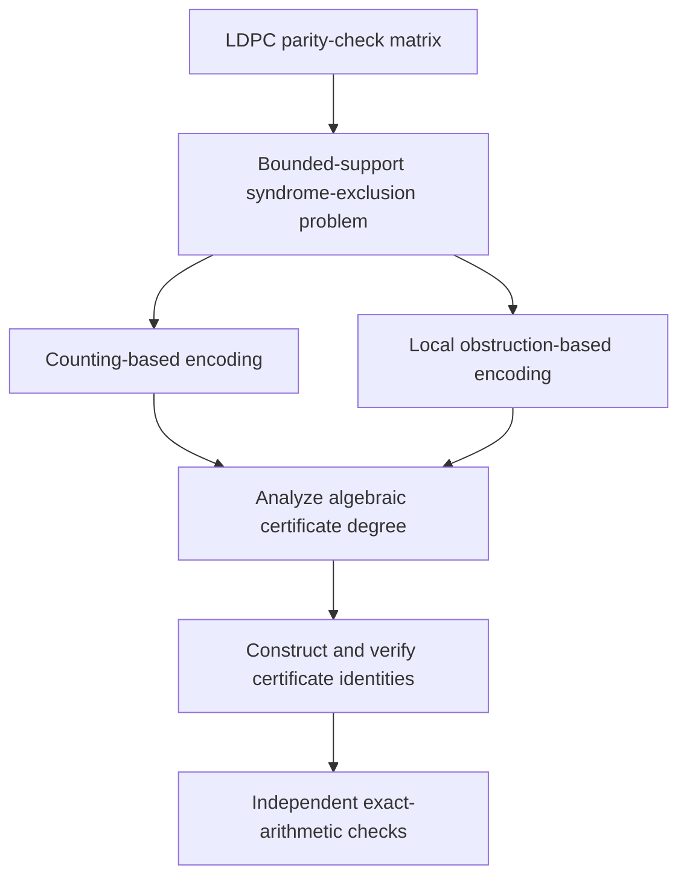

# Algebraic Certification of Syndrome Exclusion in LDPC Codes

**Research portfolio | Coding theory | Computational algebra | Formal verification | Scientific computing**

**Manuscript:** *Encoding-Sensitive Nullstellensatz Certificates for Bounded-Support Syndrome Exclusion in LDPC Codes*  
**Submission:** 2027 IEEE Information Theory Workshop (ITW 2027)  
**Status:** Under review (not accepted or published)

## Research team

| Author | Affiliation |
| --- | --- |
| **Malihe Aliasgari** | Department of Mathematical Sciences, School of Integrative Science and Technology, Kean University, USA |
| **Hassan Khodaiemehr** | School of Engineering, Faculty of Applied Science, University of British Columbia, Okanagan Campus, Canada |
| **Khadijeh Bagheri** | School of Engineering, Faculty of Applied Science, University of British Columbia, Okanagan Campus, Canada |

*This is collaborative research. The author order follows the ITW manuscript; individual contributions are not assigned here.*

## Project overview

Low-density parity-check (LDPC) codes are used to support reliable digital communication. An important problem is certifying that a parity-check matrix contains **no small, nonempty set of variable nodes that leaves only a limited number of parity checks unsatisfied**. Such configurations are relevant to minimum-distance and trapping-set analysis.

This project studies how the **mathematical formulation of an exclusion problem changes the complexity of proving infeasibility**. Instead of proposing a new decoder or a faster trapping-set search algorithm, the research constructs algebraic certificates that can be independently checked.

## Research question

**Can two polynomial encodings with exactly the same feasible solutions require different degrees of algebraic certification?**

The manuscript examines this question using exact polynomial formulations over the rational numbers, constructive Nullstellensatz certificates, cycle-code examples, and independent verification.

## Technical approach

- **Exact mathematical formulations:** Compare a counting-based encoding with a local encoding based on inclusion-exclusion and cardinality obstructions.
- **Constructive certificates:** Develop explicitly checkable Nullstellensatz identities for infeasible bounded-support syndrome-exclusion instances.
- **Certificate-degree analysis:** Establish a local degree bound determined by the support limit, unsatisfied-check limit, and maximum check degree—not by block length when those parameters are fixed.
- **Structured examples:** Examine finite certificate-degree separations on cycle codes and selected quasi-cyclic LDPC (QC-LDPC) matrices.
- **Independent computational verification:** Use exact rational arithmetic with independent Python and C++/GMP implementations to check generated certificates.

## Research workflow

## What the work demonstrates

- Mathematically equivalent models can have different requirements for algebraic proof certificates.
- Explicit proof objects can be checked separately from the implementation that constructed them.
- Computational experiments can be validated through exact arithmetic and independent implementations.

**Scope:** The ITW version establishes *finite* examples of certificate-degree separation. It does **not** establish an asymptotic separation, faster decoding, improved error-correction performance, or a faster general-purpose search algorithm. This repository presents only the work described in the ITW 2027 submission.

## Technical competencies illustrated

- Algorithmic and mathematical problem formulation
- Coding theory, sparse graphs, and combinatorial structures
- Computational algebra and exact arithmetic
- Independent verification and computational validation
- Scientific research documentation and reproducibility

## Public repository scope

This repository is a **research portfolio overview**, not a public software release. To protect ongoing collaborative research, it does not include the full manuscript, unpublished proofs, original source code, experiment configurations, or certificate datasets. A separate educational example may be added following disclosure review and coauthor agreement.

## Research links

- **Research profile:** [Malihe Aliasgari](https://malihealiasgari20.github.io/)
- **GitHub:** [malihealiasgari20](https://github.com/malihealiasgari20)

*Publication and citation information will be updated if the ITW manuscript is accepted or becomes publicly available.*
